# 🚀 RareEmber™ — 90-Day Strategic Future Growth & Scaling Playbook

> **Brand:** RareEmber™ (`rareember.shop`)  
> **Founder & Chairman:** Ajay Rajbhar (Telegram ID: `5238068527`)  
> **Target Milestone:** ₹10,00,000+ GMV @ 34%+ Net Contribution Margin  
> **Operating Model:** 100% Domestic Qikink Tirupur Hub POD + Next.js 16 (Mumbai `bom1`) + Supabase  
> **Last Synchronized:** October 16, 2026  

---

## 1. 📊 Executive Vision & Core Objectives

```mermaid
flowchart LR
    subgraph P1["Phase 1: Days 1–30 (AOV Engine)"]
        direction TB
        B1["3 High-Margin Bundles Live"]
        B2["bom1 Mumbai Low-Latency Compute"]
        B3["Raise Promos: DIWALI100 at ₹1,099+"]
        B4["Seed 15 Creator Review Samples"]
    end

    subgraph P2["Phase 2: Days 31–60 (Creator & SEO)"]
        direction TB
        C1["25/mo Micro-Creator Barter Seeding"]
        C2["B2B College Merch: /custom-drops"]
        C3["Programmatic SEO Comparison Guides"]
    end

    subgraph P3["Phase 3: Days 61–90 (Paid Scale)"]
        direction TB
        D1["Meta Advantage+ & Google Shopping"]
        D2["Turn RTO into 24h Express Drops"]
        D3["7-Day Post-Delivery Repeat Loop"]
    end

    P1 ==> P2 ==> P3
```

### Primary Growth Targets:
1. **Average Order Value (AOV):** Push baseline from ₹499 to **₹899 – ₹1,199** via curated multi-item bundles.
2. **Net Contribution Margin Floor:** Lock minimum net profit at **34%–45%** after factoring in COGS, logistics, GST (5%), Razorpay fee (2.36%), and RTO buffer.
3. **Return-to-Origin (RTO) Defense:** Maintain RTO **below 8%** via COD WhatsApp verification and ₹30 instant UPI prepaid discount.
4. **Acquisition Blended CAC:** Maintain customer acquisition cost below ₹160/order.

---

## 2. 🗓️ 90-Day Execution Calendar

### 🟢 Phase 1: Days 1–30 — AOV & Conversion Engine
*Goal: Establish high-margin unit economics, seed customer social proof, and eliminate checkout friction.*

1. **Deploy 3 High-Margin Curated Bundles:**
   * **The Streetwear Duo (₹899):** Any two 240+ GSM Oversized Tees (saves customer ₹299; combined shipping nets ₹313 profit).
   * **The Creator Workstation Pack (₹1,199):** 900x400mm Gaming Desk Mat + 240 GSM Graphic Tee + Ceramic Coffee Mug (nets ₹416 profit).
   * **Winter Heavyweight Combo (₹1,199):** 380 GSM French Terry Fleece Hoodie + Graphic Tee (nets ₹392 profit).
2. **In-Cart 1-Click Micro Upsells:**
   * Offer a ₹199 waterproof acrylic coaster set or ₹249 350 GSM canvas tote inside the slide-out cart drawer for an extra ₹149.
3. **Protected Promo Code Minimums:**
   * `FIRST50`: Requires ₹699+ cart minimum.
   * `DIWALI100`: Requires ₹1,099+ cart minimum (protects against single-tee margin collapse).
   * `PREPAID30`: Flat ₹30 instant discount on 100% Prepaid UPI to kill COD RTO risk.
4. **Seed Social Proof (Photo Reviews):**
   * Order 10–15 sample units of flagship drops for local college students and tech desk-setup micro-creators in Tier 1/2 cities.
   * Collect and publish 30+ verified photo reviews into Supabase `reviews` table.
5. **Infrastructure Co-Location:**
   * Vercel compute co-located in Mumbai (`bom1`) next to Supabase (`ap-south-1`) for <10ms database query latency.

---

### 🟡 Phase 2: Days 31–60 — Organic & Creator Acquisition Loop
*Goal: Build scalable, zero-ad-spend traffic channels and tap into high-margin bulk orders.*

1. **Micro-Creator Barter Seeding Engine:**
   * Ship 25 custom-packaged units per month (costing ~₹290–₹335 landed per unit) to Indian Instagram Reels and YouTube Shorts creators (5k–50k followers in coding, gaming, desk setups, and college streetwear).
   * In exchange, creators post unboxing Reels/Stories highlighting RareEmber's 100% custom white-label packaging and tagging `@RareEmber`.
2. **B2B College & Hackathon Merch (`/custom-drops`):**
   * Target tech fests, college clubs, and startup hackathons across Bengaluru, Pune, Delhi NCR, and Mumbai.
   * Offer zero-MOQ or 25+ unit custom DTF hoodies/tees fulfilled via Qikink with upfront 100% prepaid billing.
   * Unit economics on 30 hoodies: ₹22,500 retail vs ₹13,500 COGS = **₹7,350 net profit with ZERO RTO risk**.
3. **Programmatic SEO & High-Intent Buyer Guides:**
   * Expand our 17 Supabase blog posts into targeted buyer comparisons with embedded product cards and Google Merchant Center JSON-LD schema (e.g. *"Best 900x400mm Desk Mats for Programmers in India Under ₹700"*).

---

### 🔴 Phase 3: Days 61–90 — Paid Scale & Retention Flywheel
*Goal: Systematically scale profitable paid traffic and monetize repeat buyers.*

1. **Deploy Meta Advantage+ & Google Shopping Campaigns:**
   * Submit live XML feed (`https://www.rareember.shop/api/feed/google`) to Google Merchant Center for Free Listings + Google Performance Max Shopping ads.
   * Launch Meta Advantage+ Shopping Campaigns (ASC) restricted strictly to the top 10 highest-converting SKUs and curated bundles with ₹899+ AOV.
   * Initial test budget: ₹300–₹500/day; scale only when ROAS exceeds 2.8x.
2. **Turn RTO Stock into "24-Hour Express Drops":**
   * When a COD shipment is returned, have it routed to your local address.
   * Inspect and list it in a dedicated "Ready to Ship — 24h Dispatch" collection at a 10% discount so returned inventory converts immediately back into liquid cash.
3. **Automate Post-Purchase Repeat Drop Loop:**
   * Automated WhatsApp/Email dispatched 7 days post-delivery offering **₹150 store credit** (valid on ₹899+ orders) in exchange for uploading a photo wearing the tee or showing the desk setup.

---

## 3. 💰 Post-Bundling Target Unit Economics

$$\text{Net Contribution} = \text{Selling Price} - \text{COGS} - \text{Logistics} - \text{Gateway Fee (2.36\%)} - \text{GST (5\%)} - \text{RTO Reserve}$$

| Order Scenario | Retail Price | Est. COGS + Shipping | Gateway + GST + RTO Reserve | Net Profit (Per Order) | Net Margin |
| :--- | :--- | :--- | :--- | :--- | :--- |
| **Single Oversized Tee (Prepaid)** | **₹499** | ₹290 | ~₹37 | **₹172** | **34.5%** |
| **The Streetwear Duo (2 Tees)** | **₹899** | ₹520 *(Combined ship)* | ~₹66 | **₹313** | **34.8%** |
| **Creator Workstation Pack (Tee+Mat+Mug)** | **₹1,199** | ₹695 *(Combined ship)* | ~₹88 | **₹416** | **34.7%** |
| **Winter Heavyweight Combo (Hoodie+Tee)** | **₹1,199** | ₹715 *(Combined ship)* | ~₹92 | **₹392** | **32.7%** |
| **B2B Bulk Hackathon Order (30 Hoodies)** | **₹22,500** | ₹13,500 | ~₹1,650 *(Zero RTO)* | **₹7,350** | **32.7%** |

---

## 4. 📈 Weekly KPI Scorecard & Milestones

| Milestone | Target Timeline | Key Metric | Target Goal |
| :--- | :--- | :--- | :--- |
| **Milestone 1** | Week 1–2 | Launch 3 Bundles & Google Merchant Feed | Feed Active & Indexed |
| **Milestone 2** | Week 3–4 | Creator Seeding & Photo Reviews | 30+ Photo Reviews in DB |
| **Milestone 3** | Week 5–6 | B2B Hackathon Merch Portal | 1st Bulk College Order |
| **Milestone 4** | Week 7–8 | Meta Advantage+ Shopping Ad Scale | ROAS ≥ 2.8x on ₹999+ Bundles |
| **Milestone 5** | Week 9–12 | Full 90-Day Flywheel & Repeat Loop | ₹10,00,000+ Total GMV Run-Rate |
