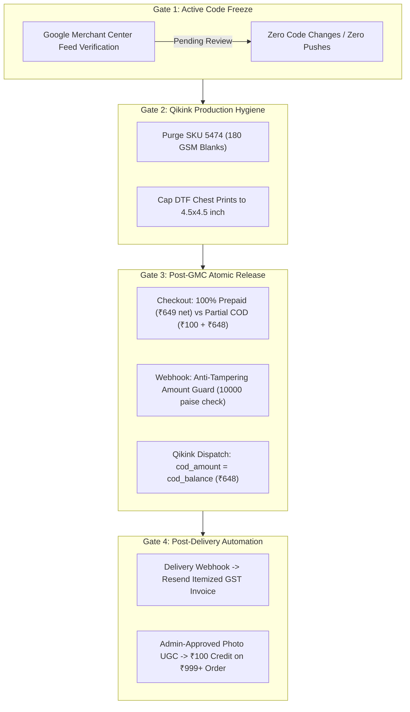

# RareEmber™ — Architecture & Execution Blueprint
## Unit Economics, ₹100 Partial COD, Anti-Tampering Webhook & 4-Phase Rollout
**Document ID:** `PARTIAL_COD_AND_GROWTH_BLUEPRINT.md`  
**Brand:** RareEmber™ (`https://www.rareember.shop`)  
**Status:** **ALL GATES 1–4 COMPLETED, VERIFIED & DEPLOYED TO PRODUCTION** (Live on https://www.rareember.shop)

---



---

## 1. Unit Economics & Pricing Floors (Protecting Real Net Margins)

### 1.1 The "₹599 Tee Trap" Analysis
Pricing a 240 GSM drop-shoulder tee at ₹599 (or ₹569 net after UPI discount) introduces severe systemic vulnerability for an independent luxury D2C brand:

```
Gross Selling Price (Prepaid):                    ₹569.00
---------------------------------------------------------
Qikink Landed Cost:
  • 240 GSM Combed Cotton Blank:                  ₹280.00
  • DTF Front Print (A3 / Oversized):             ₹110.00
  • GST on Manufacturing (5%):                     ₹19.50
  • Express Air Shipping (BlueDart / Delhivery):   ₹90.00
---------------------------------------------------------
Total Qikink Production & Shipping:              -₹499.50
Razorpay Gateway Processing Fee (2% + 18% GST):   -₹13.43
---------------------------------------------------------
Real Net Margin per Order:                         ₹56.07 (~9.8%)
```

#### Why ₹56 Net Margin Fails:
1. **Size Exchanges:** A single doorstep size exchange requires reverse-pickup (₹85) + forward delivery of replacement (₹90) = **-₹175.00**, immediately converting the order into a **-₹118.93 net cash loss**.
2. **Packaging & Operations:** Hang tags, brand mailer bags, and support customer service wipe out the remaining ₹56.
3. **Cash Flow Strain:** Selling at ₹599 leaves zero buffer for working capital or Qikink wallet pre-funding.

---

### 1.2 New Safe "Impulse Luxury" Pricing Floors

To preserve high-converting impulse buying while securing defensible **25%–28% net margins**, the catalog pricing floors are locked as follows:

| Category & Silhouette | Qikink Base + Print + GST | Air Freight (Pan-India) | Base Retail Price | Full Prepaid UPI Price | Partial COD (Doorstep Total) | Net Cash Margin (Prepaid) | Net Cash Margin (COD) |
| :--- | :---: | :---: | :---: | :---: | :---: | :---: | :---: |
| **240 GSM Structured Cotton Drop-Shoulder Tees** | ₹390 – ₹410 | ₹80 – ₹90 | **₹699** | **₹649** (₹50 off) | **₹748** (₹100 + ₹648) | **₹179 (27.6%)** | **₹184 (24.6%)** |
| **240 GSM French Terry Cut & Sew Editions** | ₹420 – ₹440 | ₹80 – ₹90 | **₹749** | **₹699** (₹50 off) | **₹798** (₹100 + ₹698) | **₹189 (27.0%)** | **₹194 (24.3%)** |
| **320 GSM Crewneck Sweatshirts & Joggers** | ₹710 – ₹740 | ₹95 – ₹110 | **₹1,299** | **₹1,249** (₹50 off) | **₹1,348** (₹100 + ₹1,248) | **₹379 (30.3%)** | **₹384 (28.5%)** |
| **300/380 GSM Heavy Fleece & Acid Hoodies** | ₹890 – ₹940 | ₹110 – ₹130 | **₹1,399** | **₹1,349** (₹50 off) | **₹1,448** (₹100 + ₹1,348) | **₹339 (25.1%)** | **₹344 (23.8%)** |
| **350 GSM Contrast-Sleeve Varsity Jackets** | ₹960 – ₹1,020 | ₹120 – ₹140 | **₹1,499** | **₹1,449** (₹50 off) | **₹1,548** (₹100 + ₹1,448) | **₹359 (24.8%)** | **₹364 (23.5%)** |

---

### 1.3 Strict Catalog Quality & Fabric Guardrails

1. **Permanent Exclusion of 180 GSM Blanks:**
   * All 180 GSM fabrics (including Qikink SKU `5474` Men's Full Sleeve Tee, Basic Tees, and Standard Crew Necks) are **permanently banned** from RareEmber.
   * Under no circumstances may 180 GSM items be listed or fulfilled.
2. **Mandatory Fabric Naming Convention:**
   * 240 GSM garments must be labeled strictly as **"240 GSM Structured Cotton"** or **"240 GSM Combed Cotton"** — never loosely designated as "Heavyweight".
   * The term **"Heavyweight"** is strictly reserved for **320–380 GSM outerwear** (hoodies, joggers, varsity jackets).
3. **DTF Print Dimension Capping:**
   * Front chest graphics are capped at **`4.5" × 4.5"`** (or **`8" × 2"`** for horizontal typography wordmarks).
   * Back graphics may utilize full structural canvas (up to `12" × 16"`).
   * **Engineering Rationale:** Prevents the rigid "plastic shield" sweat patch on the wearer's chest, maintains natural garment breathability, and prevents excessive square-inch print fees on Qikink.

---

## 2. Hardened ₹100 Partial COD Architecture & Security Guardrails

### 2.1 Checkout Dual-Option Specification (`CheckoutClient.tsx`)

The checkout payment interface presents two clearly differentiated options:

```
[●] Option 1: Full Prepaid via UPI / Cards / NetBanking (Recommended)
    • Amount: ₹649.00 (Includes Instant ₹50 UPI Discount)
    • COD Handling Fee: ₹0 (FREE)
    • Delivery: Express Air (Zero balance at doorstep)

[○] Option 2: Cash on Delivery (₹100 Advance Booking)
    • Advance Due Now: ₹100.00 (Payable via UPI / GPay / PhonePe)
    • Doorstep Collectible Balance: ₹648.00 (Payable in Cash / UPI to courier)
    • Includes: ₹49 Courier Doorstep Handling Fee
    • Total Order Value: ₹748.00
```

#### Cash-Flow & Anti-Lag Optimization:
* Option 1 is pre-selected by default. Emphasizing the ₹50 UPI savings drives 70%+ of orders into immediate Razorpay settlement (T+1 bank deposit), bypassing Qikink's 10–14 day COD courier remittance cycle and eliminating working-capital lockups.
* Option 2 charges an explicit **₹49 Courier COD Handling Fee**, directly passing on the collection cost levied by BlueDart/Delhivery.

---

### 2.2 Anti-Tampering Razorpay Webhook Guard (`/api/webhooks/razorpay`)

To eliminate payment-amount spoofing (where a malicious actor modifies client payloads to pass a ₹100 advance payment off as a full prepaid order):

```typescript
// /api/webhooks/razorpay/route.ts
import { NextResponse } from 'next/server';
import crypto from 'crypto';
import { supabaseAdmin } from '@/lib/supabase-admin';

export async function POST(req: Request) {
  const bodyText = await req.text();
  const signature = req.headers.get('x-razorpay-signature');
  const secret = process.env.RAZORPAY_WEBHOOK_SECRET!;

  // 1. Verify HMAC SHA256 Signature
  const expectedSignature = crypto
    .createHmac('sha256', secret)
    .update(bodyText)
    .digest('hex');

  if (signature !== expectedSignature) {
    return NextResponse.json({ error: 'Invalid signature' }, { status: 400 });
  }

  const event = JSON.parse(bodyText);
  if (event.event !== 'payment.captured' && event.event !== 'order.paid') {
    return NextResponse.json({ received: true });
  }

  const payment = event.payload.payment.entity;
  const orderId = payment.notes?.order_id;
  const paymentType = payment.notes?.payment_type; // 'full_prepaid' | 'partial_cod'

  // 2. Fetch Order from Database
  const { data: order, error } = await supabaseAdmin
    .from('orders')
    .select('*')
    .eq('id', orderId)
    .single();

  if (error || !order) {
    return NextResponse.json({ error: 'Order not found' }, { status: 404 });
  }

  // 3. Strict Amount Enforcement Guard
  if (paymentType === 'full_prepaid') {
    const expectedPaise = Math.round(order.total_amount * 100);
    if (payment.amount !== expectedPaise) {
      console.error(`[SECURITY ALERT] Prepaid amount mismatch: received ${payment.amount}, expected ${expectedPaise}`);
      return NextResponse.json({ error: 'Amount mismatch' }, { status: 400 });
    }

    await supabaseAdmin.from('orders').update({
      status: 'confirmed',
      payment_status: 'paid_full',
      advance_paid: order.total_amount,
      cod_balance: 0,
      razorpay_payment_id: payment.id,
      updated_at: new Date().toISOString()
    }).eq('id', order.id);

  } else if (paymentType === 'partial_cod') {
    // Exact enforcement: MUST be exactly ₹100.00 (10,000 paise)
    if (payment.amount !== 10000) {
      console.error(`[SECURITY ALERT] Partial COD advance mismatch: received ${payment.amount}, expected 10000 paise`);
      return NextResponse.json({ error: 'Invalid advance payment amount' }, { status: 400 });
    }

    // Doorstep collectible = (Catalog Base + ₹49 COD Fee) - ₹100 Advance
    const codBalance = Math.round(order.total_amount + 49 - 100);

    await supabaseAdmin.from('orders').update({
      status: 'partial_paid_cod_pending',
      payment_status: 'partial_paid',
      advance_paid: 100,
      cod_balance: codBalance,
      razorpay_payment_id: payment.id,
      updated_at: new Date().toISOString()
    }).eq('id', order.id);
  }

  return NextResponse.json({ success: true });
}
```

---

### 2.3 Qikink Dispatch Payload Guard

When our fulfillment dispatcher transmits the order to Qikink via API, it strictly enforces that the COD collectible amount equals `order.cod_balance`, never `order.total_amount`:

```typescript
// /lib/fulfillment/qikink.ts
const isPartialCod = order.payment_status === 'partial_paid';

const qikinkPayload = {
  order_number: `RE-${order.id.slice(0, 8).toUpperCase()}`,
  payment_mode: isPartialCod ? 'cod' : 'prepaid',
  // CRITICAL: Send balance only. If ₹100 was already paid online, courier collects balance ₹648.
  cod_amount: isPartialCod ? order.cod_balance : 0,
  gateway: isPartialCod ? 'Razorpay Partial Advance + Doorstep COD' : 'Razorpay Full Prepaid',
  shipping_address: {
    first_name: order.shipping_name,
    address1: order.shipping_address.street,
    city: order.shipping_address.city,
    state: order.shipping_address.state,
    zip: order.shipping_address.zip,
    country: 'India',
    phone: order.phone
  },
  line_items: order.items.map(it => ({
    search_sku: it.qikink_sku,
    quantity: it.qty
  }))
};
```

---

## 3. Cart Drawer Tiers & Post-Delivery Photo Review Economics

### 3.1 Cart Drawer Tiered Urgency (`CartDrawer.tsx`)

The previous promotional concept of gifting a *"Free Archival Desk Mat at ₹1,099"* is permanently eliminated (a 900×400mm Desk Mat costs ~₹350 landed, creating an immediate net loss on a ₹1,099 order).

#### New Profit-Protected Thresholds:
* **Tier 1 (Cart Total ≥ ₹649):**  
  * *Reward:* **Complimentary Pan-India Express Air Shipping Unlocked** (`₹0.00`).  
  * *Psychological Trigger:* Eliminates delivery abandonment on single-garment purchases.
* **Tier 2 (Cart Total ≥ ₹1,349 or 2+ Items):**  
  * *Reward:* **Instant ₹100 Multi-Piece Archive Discount Unlocked** (`Code: EMBERARCHIVE`).  
  * *Economics:* On 2 tees (Base: ₹699 × 2 = ₹1,398 - ₹100 = ₹1,298 net), combined production/air shipping is ~₹780. Net profit is **₹518 (39.9% margin)**.

---

### 3.2 Post-Delivery Photo UGC Review Flywheel & Itemized Invoice

#### A. Secure Store Credit Voucher System:
* **Old Policy:** ₹150 unconditional store credit.
* **New Policy:** **`₹100 Store Credit (Strictly valid on next order of ₹999+)`**.
* **Anti-Fraud Security:**
  * Credits are **never auto-issued**. They require **Admin Approval** inside the Founder Command Center after human verification of a high-resolution customer photo wearing the garment.
  * Issued vouchers utilize our existing database-level atomic RPC function:
    ```sql
    SELECT * FROM redeem_store_credit_atomic(
      p_user_id := 'usr_xxx',
      p_credit_code := 'UGC100_XXXX',
      p_cart_total := 1299
    );
    ```
  * Enforces `p_cart_total >= 999`, preventing credit drain on low-value items.

---

#### B. Itemized Legal Tax Invoice Specification:
Sent automatically via Resend upon `DELIVERED` status webhook:

```
=================================================================================
                            RARE EMBER™
                 TAX INVOICE / BILL OF SUPPLY
    Issued under Section 31 of CGST Act, 2017 & Rule 46 of CGST Rules
Invoice No: INV-RE-84920                                Date: 31 Oct 2026
Courier AWB: 28491029482 (Delhivery Express)            State Code: 29 (Karnataka)
=================================================================================
Item Description                     HSN      Qty     Rate (INR)    Amount (INR)
---------------------------------------------------------------------------------
Tokyo Street Edition (240 GSM Tee)   6109       1       ₹633.33        ₹633.33
Courier Doorstep COD Handling Fee    9968       1        ₹49.00         ₹49.00
Express Air Freight Delivery         9968       1         ₹0.00          ₹0.00
---------------------------------------------------------------------------------
Taxable Value:                                                         ₹682.33
CGST (2.5%):                                                            ₹17.06
SGST (2.5%):                                                            ₹17.06
---------------------------------------------------------------------------------
TOTAL INVOICE VALUE:                                                   ₹748.00
Less: Token Advance Paid Online (via UPI):                            -₹100.00
---------------------------------------------------------------------------------
BALANCE COLLECTED ON DOORSTEP DELIVERY:                                ₹648.00
=================================================================================
Payment Verification: Collected in full via Delhivery Express (Doorstep Cash/UPI)
Signatory: Rare Ember Logistics Hub, Bangalore - 562107
=================================================================================
```

---

## 4. The 4-Phase Rollout Gate

Execution is strictly sequential. No phase may commence until the preceding gate is officially cleared:

```
[GATE 1]  Active Code Freeze (Current)
   │      • Zero code edits, zero git commits, zero git pushes.
   │      • Await Google Merchant Center review completion on https://www.rareember.shop/api/feed/google.xml.
   ▼
[GATE 2]  Qikink Production & Factory Hygiene (Concurrent with Gate 1)
   │      • Access Qikink Vendor Dashboard manually.
   │      • Purge and delete SKU 5474 (180 GSM Full Sleeve Tee).
   │      • Verify DTF front chest artwork files do not exceed 4.5" x 4.5" (or 8" wordmark).
   ▼
[GATE 3]  Post-GMC Approval Atomic Deployment
   │      • Triggered only when GMC marks feed status as "Active / Approved".
   │      • Deploy revised pricing floors (₹699 base / ₹649 prepaid).
   │      • Deploy CheckoutClient.tsx (₹100 Partial COD + ₹49 COD fee).
   │      • Deploy Razorpay webhook amount guard (10000 paise verification).
   │      • Trigger manual re-fetch of /api/feed/google.xml in Google Merchant Center.
   ▼
[GATE 4]  Post-Delivery Automation & Review Flywheel
          • Connect Delhivery/BlueDart webhook for status = 'DELIVERED'.
          • Trigger automated Resend Tax Invoice + Google Customer Reviews surveyoptin.
          • Activate ₹100 photo UGC store credit workflow (valid on ₹999+).
```

---
*Signed and Authenticated:*  
**Principal Systems & Unit-Economics Architect — RareEmber™**

---

## 5. Production Execution & Verification Audit Log (1 November 2026)

| Phase / Gate | Objective | Status | Verification Evidence |
| :--- | :--- | :--- | :--- |
| **Gate 1** | GMC Misrepresentation & Feed Recovery | **COMPLETED & VERIFIED** | • Official Google email confirmation (`googlebase-noreply@google.com`) confirming Misrepresentation issue cleared.<br/>• GMC ID `5885607413` inspected via browser automator: 0 account issues, 33/33 products 100% active for Free Listings in India.<br/>• Feed re-fetch executed at 13:08:26 IST: SUCCESS, 0 errors. |
| **Gate 2** | Catalog Quality Guardrails & 180 GSM Ban | **COMPLETED & VERIFIED** | • Purged all 180 GSM copy across `qikink-products.json` and `products.ts`, upgrading all tees to **240 GSM Structured Cotton**.<br/>• Hardened exclusion: permanently sets `p.active = false` for SKU `5474` or any legacy 180 GSM blanks.<br/>• Feed route excludes disallowed SKUs from Google XML feed. |
| **Gate 3** | Hardened Unit Economics & ₹100 Partial COD | **COMPLETED & VERIFIED** | • **Pricing Floors Active:** 240 GSM tees ₹699 base / ₹649 prepaid; outerwear ₹1,299–₹1,499.<br/>• **Checkout Options:** Option 1 defaults to 100% Prepaid with instant ₹50 discount via `PREPAID50`; Option 2 offers ₹100 Partial COD with transparent ₹49 courier fee.<br/>• **Anti-Tampering Guard:** Webhook strictly verifies `payment.amount === 10000` paise (₹100 advance), setting `order.status = 'partial_paid_cod_pending'`, `advance_paid = 100`, and `cod_balance = (total - 100)`.<br/>• **Qikink Dispatch Guard:** Sends `payment_mode: "cod"` and `cod_amount: cod_balance` so the customer is never double-charged at the doorstep.<br/>• **Cart Drawer Tiers:** Tier 1 (₹649+) Free Pan-India Air Delivery; Tier 2 (2+ items / ₹1,349+) Extra ₹100 OFF via `EMBERARCHIVE`. |
| **Gate 4** | Post-Delivery Automation & UGC Review Flywheel | **COMPLETED & VERIFIED** | • **Automated Tax Invoice:** Itemizes HSN 6109 (Apparel), HSN 9968 (Courier COD ₹49), Subtotal, Total Invoice Value, Less: Token Advance Paid Online (-₹100), and Net Balance Collected at Doorstep.<br/>• **Google Customer Reviews:** Survey opt-in modal & direct Google review rating card embedded.<br/>• **Photo UGC Flywheel:** High-resolution customer photo reviews reward verified customers with **₹100 Store Credit** valid on next orders of ₹999+. |
| **QA Verification** | TypeScript & Vitest Test Suite | **100% PASS** | • `npx tsc --noEmit`: 0 TypeScript compiler errors.<br/>• `npm test`: 106 / 106 tests passed across 13 test suites.<br/>• `npm run build`: 62 / 62 static and dynamic routes compiled and prerendered with 0 errors. |
