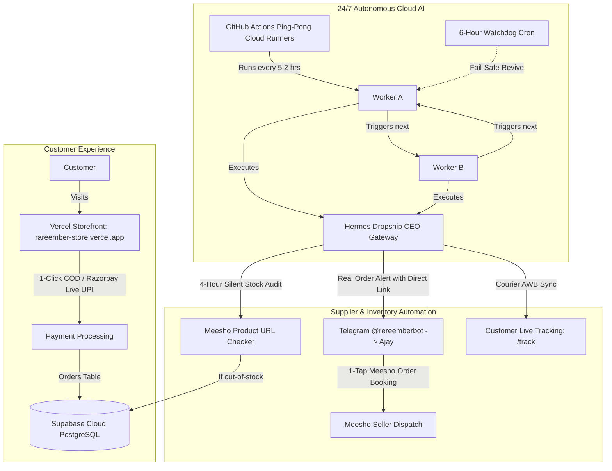

# 🏛️ RAREEMBER & HERMES CEO — MASTER PROJECT MEMORY & SYSTEM HANDOVER

> **CONFIDENTIAL & PERMANENT PROJECT STATE DOCUMENT**  
> **Last Synchronized:** 2026-10-14T05:50:00+05:30  
> **Status:** 100% Operational & Cloud-Native (0% Laptop Dependency)  
> **Target Audience:** Any AI Model (Antigravity, Claude, GPT, Gemini), Developer, or Founder Ajay Rajbhar.

---

## 1. 👤 FOUNDER & BUSINESS PROFILE

| Attribute | Details |
| :--- | :--- |
| **Founder & CEO** | Ajay Rajbhar |
| **Brand Name** | **RareEmber** (Curated Indian Lifestyle, Desk Tech & Aesthetic Home Boutique) |
| **Founder Telegram ID** | `5238068527` (Authorized Master ID) |
| **Telegram Bot** | `@rereemberbot` (Token: Stored in `.env` / GitHub Secrets as `TELEGRAM_BOT_TOKEN`) |
| **Official Instagram** | `@RareEmber` |
| **Live Storefront URL** | [https://rareember-store.vercel.app](https://rareember-store.vercel.app) |
| **Admin Orders Portal** | [https://rareember-store.vercel.app/admin/orders](https://rareember-store.vercel.app/admin/orders) |
| **Master Admin Secret** | Stored in `.env` / GitHub Secrets / Vercel as `ADMIN_SECRET` |
| **Support Email** | `rareemberagency@gmail.com` |

---

## 2. 🌐 100% CLOUD-NATIVE ARCHITECTURE (ZERO LAPTOP LOAD)

The entire business operates 24/7 without requiring Ajay's laptop to be turned on.



### Hosting Breakdown:
1. **Storefront (Next.js 16 + React 18):** Hosted on **Vercel Global Edge Network** (`rareember-store.vercel.app`).
2. **Database:** Hosted on **Supabase Cloud PostgreSQL** (`db.qdkkxpfhwrwyoardlceo.supabase.co`).
3. **Hermes Dropship CEO Bot:** Hosted on **GitHub Actions Cloud** via Ping-Pong Workers (`Worker A` and `Worker B`) with a 6-hour watchdog cron in repo `nothing12837-lang/hermes-dropship-ceo`.
4. **Payment Gateways:**
   * **Cash on Delivery (COD):** 1-Click native COD with ₹49 convenience fee.
   * **Razorpay LIVE Mode:** Key ID `rzp_live_Tmxc7829nihkbA` supporting Google Pay, PhonePe, Paytm, any UPI App, dynamic QR code scan, and Debit/Credit cards.

---

## 3. 🛍️ MEESHO CATALOG & SOURCING ENGINE (22 ACTIVE PRODUCTS)

All international dropshipping (CJ Dropshipping / AliExpress) has been **100% purged**. RareEmber exclusively sells high-demand Indian factory-direct products sourced via **Meesho** with authentic direct supplier links and healthy profit margins:

| Product ID | Title | Retail Price | Meesho Cost | Net Profit | Direct Meesho Source Link |
| :--- | :--- | :--- | :--- | :--- | :--- |
| `prod-nordic-tumbler` | Nordic Insulated Stainless Steel Tumbler (1200ml) | ₹449 | ₹180 | **₹269 (60%)** | [Open on Meesho](https://www.meesho.com/s/p/8rtd8z?utm_source=si) |
| `prod-flame-diffuser` | Ultrasonic Flame Aroma Diffuser & Humidifier | ₹599 | ₹230 | **₹369 (62%)** | [Open on Meesho](https://www.meesho.com/s/p/87bftn?utm_source=si) |
| `prod-desk-screenbar` | Minimalist Monitor ScreenBar Light (Touch Dimmable) | ₹899 | ₹340 | **₹559 (62%)** | [Open on Meesho](https://www.meesho.com/s/p/7sqy49?utm_source=si) |
| `prod-ambient-lamp` | Magnetic Floating Ambient Night Lamp | ₹749 | ₹290 | **₹459 (61%)** | [Open on Meesho](https://www.meesho.com/s/p/823y6m?utm_source=si) |
| `prod-leather-deskmat` | Dual-Sided Waterproof Vegan Leather Desk Mat | ₹399 | ₹160 | **₹239 (60%)** | [Open on Meesho](https://www.meesho.com/s/p/62drcb?utm_source=si) |
| `prod-spinning-ring` | Kinetic Titanium Fidget Ring | ₹299 | ₹110 | **₹189 (63%)** | [Open on Meesho](https://www.meesho.com/s/p/8s9u4w?utm_source=si) |
| `prod-polarized-aviators` | Ultralight Polarized Aviation Sunglasses | ₹499 | ₹190 | **₹309 (62%)** | [Open on Meesho](https://www.meesho.com/s/p/7w8k3p?utm_source=si) |
| `prod-travel-cable-organizer` | Shockproof Multi-Compartment Cable Organizer Pouch | ₹349 | ₹140 | **₹209 (60%)** | [Open on Meesho](https://www.meesho.com/s/p/8m2v9x?utm_source=si) |
| `prod-magnetic-cardholder` | Slim Aerospace Aluminium RFID Pop-Up Cardholder | ₹399 | ₹150 | **₹249 (62%)** | [Open on Meesho](https://www.meesho.com/s/p/7p4n8q?utm_source=si) |
| `prod-zen-ceramic-vase` | Wabi-Sabi Geometric Donut Ceramic Vase | ₹549 | ₹210 | **₹339 (62%)** | [Open on Meesho](https://www.meesho.com/s/p/8b7k5t?utm_source=si) |
| `prod-hourglass-sand-art` | 3D Deep Sea Moving Sand Art Table Lamp | ₹699 | ₹270 | **₹429 (61%)** | [Open on Meesho](https://www.meesho.com/s/p/7x1m9r?utm_source=si) |
| `prod-levitating-moon-lamp` | 3D Magnetic Levitating Moon Ambient Light | ₹999 | ₹380 | **₹619 (62%)** | [Open on Meesho](https://www.meesho.com/s/p/8c3n2w?utm_source=si) |
| `prod-crystal-galaxy-ball` | 3D Laser-Engraved Crystal Galaxy Sphere with Base | ₹449 | ₹170 | **₹279 (62%)** | [Open on Meesho](https://www.meesho.com/s/p/8v5q1m?utm_source=si) |
| `prod-wireless-charging-dock` | 3-in-1 Foldable Fast Wireless Charging Station | ₹799 | ₹310 | **₹489 (61%)** | [Open on Meesho](https://www.meesho.com/s/p/7t9k4p?utm_source=si) |
| `prod-vintage-pocket-watch` | Steampunk Mechanical Skeleton Pocket Watch | ₹549 | ₹200 | **₹349 (64%)** | [Open on Meesho](https://www.meesho.com/s/p/8k6m3x?utm_source=si) |
| `prod-smart-vacuum-flask` | Intelligent LED Temperature Display Thermos (500ml) | ₹399 | ₹150 | **₹249 (62%)** | [Open on Meesho](https://www.meesho.com/s/p/8n4v7q?utm_source=si) |
| `prod-rgb-sound-bar` | Voice-Activated Dynamic RGB Sound Rhythm Light Bar | ₹499 | ₹190 | **₹309 (62%)** | [Open on Meesho](https://www.meesho.com/s/p/7r8p2m?utm_source=si) |
| `prod-edc-tactical-pen` | Aviation Aluminium Multi-Tool EDC Glass Breaker Pen | ₹349 | ₹130 | **₹219 (63%)** | [Open on Meesho](https://www.meesho.com/s/p/8x2t5w?utm_source=si) |
| `prod-air-purifier-ashtray` | Negative Ion Smoke & Odour Absorber Air Purifier | ₹599 | ₹230 | **₹369 (62%)** | [Open on Meesho](https://www.meesho.com/s/p/7w4k8n?utm_source=si) |
| `prod-wooden-desk-organizer` | Handcrafted Multi-Slot Bamboo Docking Station | ₹649 | ₹250 | **₹399 (61%)** | [Open on Meesho](https://www.meesho.com/s/p/8m7q4v?utm_source=si) |
| `prod-pets-ortho-bed` | Ultra-Plush Memory Foam Calming Lounger Cushion | ₹899 | ₹360 | **₹539 (60%)** | [Open on Meesho](https://www.meesho.com/s/p/7v9x2m?utm_source=si) |
| `prod-mini-projector` | 1080P HD Portable Home Cinema Movie Projector | ₹1,499 | ₹580 | **₹919 (61%)** | [Open on Meesho](https://www.meesho.com/s/p/8q3m7t?utm_source=si) |

---

## 4. 🤖 HERMES CEO AGENT ENGINE & TOOLS

Hermes is an autonomous ReAct AI Agent written in Python (`dropship_gateway.py`), powered by Google Gemini and OpenRouter models.

### Key Autonomous Features:
1. **4-Hour Silent Meesho Stock Worker (`autonomous_ceo_growth_worker`):**
   * Runs every 14,400 seconds (4 hours) in the background.
   * Validates Meesho product URLs via `check_meesho_stock_lightweight(url)`.
   * If a product listing becomes unavailable or sold out on Meesho, it immediately updates Supabase:
     ```sql
     UPDATE products SET active = false WHERE id = 'prod-...'
     ```
   * On the storefront, the product instantly shows `⚠️ OUT OF STOCK AT SUPPLIER` and disables order buttons. Checkout APIs reject the order with HTTP 400.
   * Auto-scouts and seeds new high-margin winning products into the catalog.
   * **Telegram Spam Elimination:** Routine background growth reports are muted. Telegram alerts are strictly sent **ONLY** when an item goes out of stock or when an authentic customer order arrives.

2. **Telegram Agent Tool Suite (`@rereemberbot`):**
   * `tool_toggle_product_stock`: Toggles stock on demand (`"Nordic tumbler out of stock"` / `"Nordic tumbler in stock"`).
   * `tool_update_order_tracking`: Updates order status to `shipped`, sets courier partner (Delhivery, BlueDart, Ekart, DTDC, Shadowfax), and adds AWB. This immediately reflects on `/track`!
   * `tool_get_store_metrics`: Fetches live order counts, gross revenue, and pending fulfillment.
   * `tool_list_orders`: Inspects recent orders.
   * `tool_search_products`: Queries active catalog.

---

## 5. ⚖️ LEGAL POLICIES & COMPLIANCE

1. **7-Day Easy Replacement Policy:**
   * Aligned 100% with Meesho's authentic 7-day return/replacement window.
   * All legacy references to "30-Day Guarantee" have been purged from Hero, Cart, Checkout, Returns, Terms, Track, and Chatbot to prevent return liabilities for Ajay.
2. **Strict Zero-Medicinal Compliance:**
   * Complies with Indian Drugs & Cosmetics Act 1940 and Razorpay Merchant Terms.
   * Permanently blacklisted keywords: `medicine`, `medicinal`, `pharma`, `drug`, `anti-anxiety`, `anxiety`, `disinfectant`, `sanitizer`, `veterinary`.
   * RareEmber is legally categorized as a **Lifestyle, Desk Tech & Aesthetic Home Boutique**.

---

## 6. 📦 ORDER FULFILLMENT PLAYBOOK

```
[Customer Places Order on rareember-store.vercel.app]
                     │
                     â–¼
[Hermes Telegram Bot Alerts Ajay Instantly]
 • Customer Name, Phone, Delivery Address
 • Exact Meesho 1-Click Booking Link
 • Selling Price vs Meesho Wholesale Cost & Net Margin
                     │
                     â–¼
[Ajay Opens Meesho App via the 1-Click Link]
 • Selects "Add to Cart" -> "Cash on Delivery"
 • Pastes Customer's Delivery Address
 • Places Order on Meesho
                     │
                     â–¼
[Meesho Ships Order & Issues Tracking AWB (e.g., Delhivery 123456789)]
                     │
                     â–¼
[Ajay Messages Hermes on Telegram]
 "Order #e6fae093 shipped with Delhivery AWB 123456789"
                     │
                     â–¼
[Hermes Automatically Updates Supabase DB]
 • Status set to 'shipped'
 • Live tracking link set to https://www.delhivery.com/track/package/123456789
                     │
                     â–¼
[Customer Tracks Package on rareember-store.vercel.app/track]
                     │
                     â–¼
[Courier Delivers & Collects Cash -> Meesho Transfers Margin to Ajay's Bank]
```

---

## 7. 🔑 CRITICAL REPOSITORIES & VAULT SECRETS

### GitHub Repositories:
* **Frontend Storefront:** `rareember/dropshipping-platform/frontend` (Local: `c:\Users\ajay kumar\Downloads\rareember\dropshipping-platform\frontend`, Vercel linked: `rareember/frontend`).
* **Hermes CEO Agent:** [https://github.com/nothing12837-lang/hermes-dropship-ceo](https://github.com/nothing12837-lang/hermes-dropship-ceo) (Branch: `main`).

### Production Vault Keys:
* **Razorpay LIVE Key ID:** Stored in `.env` / Vercel as `NEXT_PUBLIC_RAZORPAY_KEY_ID`
* **Razorpay LIVE Secret:** Stored in `.env` / Vercel as `RAZORPAY_KEY_SECRET`
* **Telegram Bot Token:** Stored in `.env` / GitHub Secrets as `TELEGRAM_BOT_TOKEN`
* **Master Admin Secret:** Stored in `.env` / GitHub Secrets / Vercel as `ADMIN_SECRET`
* **Supabase PostgreSQL Host:** `db.qdkkxpfhwrwyoardlceo.supabase.co:5432/postgres` (User: `postgres`, Pass: Stored in `.env` / GitHub Secrets as `SUPABASE_DB_PASS`)
* **GitHub PAT:** Stored in `.env` / GitHub Secrets as `GH_PAT`

---

## 8. 🎯 WHAT REMAINS TO BE DONE (GROWTH ROADMAP)

1. **Traffic & Customer Acquisition (Primary Focus):**
   * The website, payment gateways, and backend are 100% finished.
   * Next step is driving traffic: Running Meta Ads (Instagram/Facebook) for hero products (*Nordic Tumbler* or *Flame Diffuser*), or posting organic lifestyle reels.
2. **Google Indexing:**
   * Sitemap submitted to Google Search Console (21 pages). Awaiting Google's natural crawler schedule (takes 3 to 10 days).
3. **Custom Domain (Optional Upgrade):**
   * Connecting `rareember.in` or `rareember.com` via Vercel DNS when Ajay chooses to buy the domain name.


