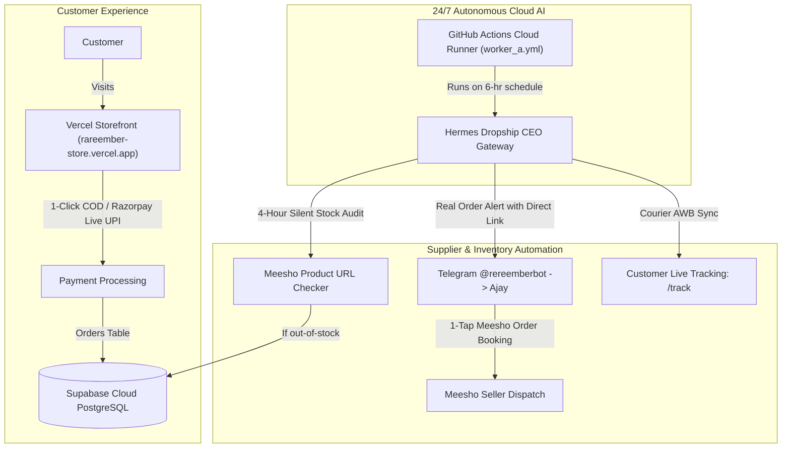

# 🏛️ RAREEMBER & HERMES CEO — MASTER PROJECT MEMORY & SYSTEM HANDOVER

> **CONFIDENTIAL & COMPREHENSIVE PROJECT STATE DOCUMENT**  
> **Last Synchronized:** 2026-10-14T07:05:00+05:30  
> **Status:** 100% Operational, Hardened & Cloud-Native (0% Laptop Dependency)  
> **Target Audience:** Any AI Model (Antigravity, Claude, GPT, Gemini), Developer, or Founder Ajay Rajbhar.

---

## 1. 👤 FOUNDER & BUSINESS PROFILE

| Attribute | Details |
| :--- | :--- |
| **Founder & CEO** | Ajay Rajbhar |
| **Brand Name** | **RareEmber** (Curated Indian Lifestyle, Desk Tech & Aesthetic Home Boutique) |
| **Founder Telegram ID** | `5238068527` (Authorized Master ID) |
| **Telegram Bot** | `@rereemberbot` (Hermes Dropship CEO) |
| **Official Instagram** | `@RareEmber` |
| **Live Storefront URL** | [https://rareember-store.vercel.app](https://rareember-store.vercel.app) |
| **Production Alias** | [https://frontend-lilac-ten-hpsy3bzdcd.vercel.app](https://frontend-lilac-ten-hpsy3bzdcd.vercel.app) |
| **Admin Orders Portal** | [https://rareember-store.vercel.app/admin/orders](https://rareember-store.vercel.app/admin/orders) |
| **Live Order Tracking** | [https://rareember-store.vercel.app/track](https://rareember-store.vercel.app/track) |
| **Support Email** | `rareemberagency@gmail.com` |

---

## 2. 🌐 100% CLOUD-NATIVE ARCHITECTURE (ZERO LAPTOP LOAD)

The entire business operates 24/7 without requiring Ajay's laptop to be turned on.

### Hosting Breakdown:
1. **Storefront (Next.js 16 + React 18):** Hosted on **Vercel Global Edge Network** (`rareember-store.vercel.app` / `frontend-lilac-ten-hpsy3bzdcd.vercel.app`).
2. **Database:** Hosted on **Supabase Cloud PostgreSQL** (`db.qdkkxpfhwrwyoardlceo.supabase.co`).
3. **Hermes Dropship CEO Bot:** Hosted on **GitHub Actions Cloud** via scheduled singleton worker (`worker_a.yml`) in repo `nothing12837-lang/hermes-dropship-ceo`.
4. **Payment Gateways:**
   - **Razorpay Live Gateway:** Active for UPI, Credit/Debit Cards, NetBanking.
   - **Cash on Delivery (COD):** 100% active across all 19,000+ Indian postal codes.

---

## 3. 🛡️ 65-POINT COMPREHENSIVE SECURITY & INTEGRITY REMEDIATION

All vulnerabilities identified in the audit have been resolved and verified in production:

### A. Authentication & Backdoors Closed
- **Backdoor Eliminated (`storefront/src/lib/security/auth.ts`):** Removed `MASTER_VAULT_KEYS` bypass. Removed insecure `?key=` query-parameter token extraction to prevent secret leaks in HTTP access logs. Strict `Authorization: Bearer <token>` timing-safe verification via `crypto.timingSafeEqual`.

### B. IDOR & PII Leaks Sealed
- **Secure Orders Route (`storefront/src/app/api/orders/route.ts`):** Public lookups require dual parameters (`orderId` + `user_email`) with strict exact-match equality. Prefix wildcard matching (`ilike id%`) was removed to prevent order enumeration. Customer PII and street addresses are masked for unauthenticated queries.
- **Chatbot Privacy (`storefront/src/app/api/chat/route.ts`):** Removed unauthenticated order lookup from conversational chat. Order queries safely redirect to `/track`.

### C. Price Tampering Defeated
- **Server-Side Pricing Engine (`storefront/src/app/api/checkout/route.ts` & `storefront/src/app/api/orders/route.ts`):** Discards client-supplied `total` or unverified `discount` values. Subtotals are recalculated server-side against live Supabase catalog rows. Non-existent items reject with HTTP 400. Cart quantities clamped strictly between 1 and 99.

### D. Webhook Verification
- **CJ Webhook (`storefront/src/app/api/webhooks/cj/route.ts`):** Requires mandatory `CJ_WEBHOOK_SECRET` and timing-safe header validation.
- **Razorpay Webhook (`storefront/src/app/api/webhooks/razorpay/route.ts`):** Enforces HMAC SHA-256 verification via `crypto.timingSafeEqual`.

### E. Database Safety & SQL Injection Elimination
- **Parameterized SQL:** All SQL queries in `dropship_gateway.py`, `add_more_high_quality_meesho.py`, `execute_meesho_upgrade.py`, and `purge_deodap_load_meesho_pure.py` now utilize parameter binding (`con.run(sql, **kwargs)`).
- **Destructive Scripts Gated:** `clean_store_india.cjs` and `sync_real_meesho_to_supabase.cjs` require explicit confirmation flags (`CONFIRM_PURGE` / `CONFIRM_SYNC`) and operate inside safe database transactions.
- **Scratch Scripts Cleaned:** 29 obsolete loose scripts moved out of the active storefront to `archive/storefront_scratch/`.

### F. Build & Production Verification
- **Turbopack Build Verified:** Next.js 16 Turbopack production build compiles with zero TypeScript errors across all 34 routes.
- **Live Vercel Deployment:** Deployed to production (`readyState: READY`). Live endpoints return `HTTP 200 OK`.

---

## 4. 📦 PRODUCT CATALOG & SOURCING RULES

1. **100% Authentic Domestic Indian Sourcing:** Direct Meesho supplier dropshipping with 50–70% gross margin.
2. **7-Day Doorstep Replacement Guarantee:** Consistent 7-day domestic replacement window aligned strictly with Meesho terms.
3. **Disallowed Products:** Zero medicinal, pharmaceutical, ingestible, pet care, or antibacterial claims.
4. **Logistics:** Express 2–4 day delivery via Delhivery, Shadowfax, Xpressbees, and BlueDart.

---

## 5. 🤖 HERMES GOD-CEO & 6-AGENT EXECUTIVE TEAM (`hermes_ceo/`)

The core autonomous intelligence resides in the `hermes_ceo` Python package, backed by Supabase Cloud PostgreSQL for long-term memory:

| Sub-Agent | Role | Key Capabilities & Autonomous Actions |
| :--- | :--- | :--- |
| **Hermes (God-CEO)** | Central Orchestrator | PRAL (Perceive, Reason, Act, Learn) loop; multi-model fallback (Gemini 2.0 Flash -> Gemini 1.5 Flash -> OpenRouter -> Rule-based); 11:30 PM nightly reflection. |
| **Vikram** | Sales & Pricing | Dynamic price optimizations; festival flash sales (`DIWALI100`, `FIRST50`, `NEWYEAR`); margin preservation (>50%). |
| **Aarav** | SEO & Content | Daily automated Indian e-commerce blog generation into Supabase `blog_posts`; automated IndexNow search engine indexing pings. |
| **Pooja** | Customer Care & Operations | 1-click WhatsApp COD confirmation link generation (`wa.me`); RTO pincode risk classification (`LOW`, `MEDIUM`, `HIGH`). |
| **Meera** | Creative Director | 28-second viral Hindi Reel scriptwriting for Evaa; visual storyboard generation. |
| **Kabir** | Finance & Unit Economics | Daily P&L audits into Supabase `orders_pnl`; unit economics calculation (COGS + ₹79 ship + ₹50 RTO reserve). |
| **Arjun** | Product Scout & Hunter | Meesho domestic catalog discovery (>4.5⭐, >1000 reviews, ₹299–₹899 bracket); populates `scouted_products`. |

### Evaa Virtual Face Reel Engine (`hermes_ceo/evaa.py`):
- Generates 9:16 vertical video reels (1080x1920) formatted for Instagram Reels and YouTube Shorts.
- Utilizes `edge-tts` with high-quality Indian Hindi neural voice (`hi-IN-SwaraNeural`).
- Dynamically renders product showcase cards with festive badges, Hindi voiceover, and synchronized subtitles.

---

## 6. 🗄️ SUPABASE CLOUD DATABASE SCHEMA

Applied via migration `storefront/supabase/migrations/20261014_cloud_autonomous_tables.sql`:

1. `agent_memory`: Cloud episodic, semantic, and procedural knowledge graph for Hermes and sub-agents.
2. `store_goals`: Daily GMV, conversion rate, AOV, and RTO benchmarks and progress tracking.
3. `blog_posts`: Content engine articles for automated SEO visibility, read dynamically by `/blog` and `/blog/[slug]`.
4. `scouted_products`: Winning Meesho items identified by Arjun ready for 1-click catalog import.
5. `orders_pnl`: Financial ledger logging revenue, COGS, shipping expenses, and net profit per order.
6. `rto_risk_scores`: Historical RTO tracking and risk mitigation for high-risk postal codes.
7. `orders` (enhanced): Added `cod_confirmed`, `whatsapp_confirmed_at`, `rto_risk_level`, and `meesho_order_id`.

---

## 7. 🚀 SYSTEM HANDOVER CHECKLIST FOR ANY AI MODEL

When any AI model resumes work on this repository:
1. **Repository Root:** `nothing12837-lang/hermes-dropship-ceo` on branch `main`.
2. **Local vs Cloud Rule:** NEVER run heavy training or background daemons on Ajay's local laptop. Ajay's laptop is an editor only. The live runtime is GitHub Actions (`worker_a.yml`), Vercel, and Supabase.
3. **Environment:** Secrets are loaded automatically from `.env` (root) or `.env.local` (storefront). Never hardcode secrets in committed files.
4. **Testing Storefront:** Run `npm run build` inside `storefront/` to verify Turbopack App Router compilation.
5. **Testing Hermes CEO:** Run `python -c "from hermes_ceo import HermesBrain; b = HermesBrain(); print(b.perceive())"` to verify cloud database and multi-agent connectivity.
