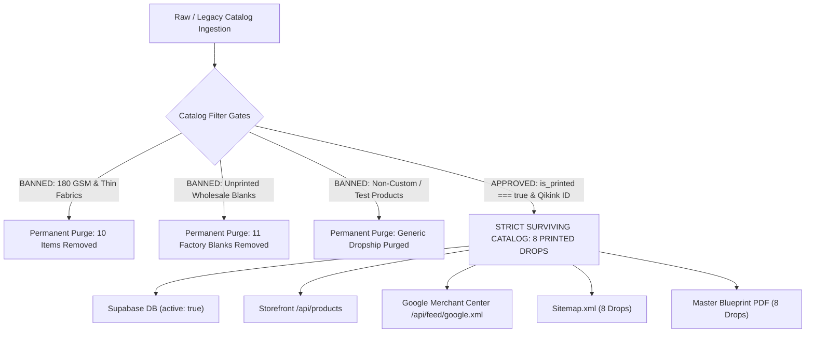

# 🏛️ RARE EMBER — MASTER PROJECT MEMORY & PERMANENT ARCHITECTURAL LEDGER

> **CONFIDENTIAL & COMPREHENSIVE BRAND & SYSTEM RECORD**  
> **Last Synchronized:** 2026-11-01T20:24:00+05:30  
> **Brand:** Rare Ember ([https://www.rareember.shop](https://www.rareember.shop))  
> **Founder & Owner:** Ajay Rajbhar  
> **Brand Category:** Luxury Architectural Heavyweight Streetwear (Custom-Printed Drops)  
> **Production Status:** 100% Live on Vercel Edge (`dpl_8KjzVbJSKYzPcoEKq5khfzBTuBqL`), Supabase PostgreSQL, Qikink POD API, Razorpay Live UPI & Email COD OTP.

---

## 1. 📋 EXECUTIVE SUMMARY OF WHAT WAS REMOVED VS. WHAT WAS ADDED / KEPT

This ledger records every catalog transition, purge, and addition to prevent any regression or accidental re-addition by future agents or automated routines.

---

## 2. 🚫 EVERYTHING THAT WAS REMOVED & PURGED (PERMANENT BAN)

### A. The 180 GSM & Thin Fabrics Purge
In compliance with Rare Ember's luxury heavyweight brand standard, **all 180 GSM and lightweight apparel are permanently banned**:
1. **Everyday Classic Crew & Basic Tees** (₹230 blank / ₹699 retail — 180 GSM).
2. **Women's Crops, Baby Tees, Tank Tops & T-Shirt Dresses** (₹200 blank / ₹649 retail — 180 GSM).
3. **Men's Full-Sleeve T-Shirts & T-Shirt Dresses** (₹310 blank / ₹849 retail — Qikink SKU `5474` 180 GSM).
4. **All Thin Sub-240 GSM Variants**: Raglan tees, Ringer tees, Stretch tees, DryFit polyester gym tees, V-Neck tees, Baby rompers, and Kids apparel.
*Reason for Purge:* Qikink does not manufacture 240 GSM full-sleeve tees, crops, tanks, or basic crewnecks. All map to flimsy 180 GSM blanks that destroy streetwear drape, cause customer dissatisfaction, and violate brand standards.

### B. The Unprinted Wholesale Factory Blanks Purge
When 180 GSM items were initially cleared, a previous automated script pulled 11 raw wholesale apparel blanks from Qikink's general catalog to fill category gaps. **These have all been completely wiped**:
1. `rare-ember-acid-wash-oversized-t-shirt` (`qikink-t-shirts-acid-wash-oversized-t-shirt-uc61` — Blank `UC61`)
2. `rare-ember-terry-oversized-t-shirt` (`qikink-t-shirts-terry-oversized-t-shirt-ut27` — Blank `UT27`)
3. `rare-ember-tie-and-dye-oversized-t-shirt` (`qikink-t-shirts-tie-and-dye-oversized-t-shirt-ut58` — Blank `UT58`)
4. `rare-ember-unisex-french-terry-sweatshirt` (`qikink-hoodies-sweatshirt-uh26` — Blank `UH26`)
5. `rare-ember-unisex-oversized-sweatshirt` (`qikink-hoodies-oversized-sweatshirt-uh35` — Blank `UH35`)
6. `rare-ember-unisex-heavyweight-joggers` (`qikink-bottomwear-joggers-uj29` — Blank `UJ29`)
7. `rare-ember-unisex-heavyweight-t-shirt` (`qikink-t-shirts-oversized-t-shirt-ua22` — Blank `UA22`)
8. `rare-ember-unisex-standard-t-shirt` (`qikink-t-shirts-oversized-standard-t-shirt-us22` — Blank `US22`)
9. `rare-ember-unisex-joggers` (`qikink-bottomwear-french-terry-joggers-uj31` — Blank `UJ31`)
10. `rare-ember-unisex-bomber-jacket` (`qikink-hoodies-bomber-jacket-ua30` — Blank `UA30`)
11. `qikink-accessories-desk-mat` (Extended Gaming Desk Mat — unprinted accessory)
*Reason for Purge:* Rare Ember is strictly an original graphic streetwear brand. Selling blank, unprinted garments dilutes brand identity, exposes wholesale supply lines, and confuses customers expecting graphic streetwear drops.

### C. Legacy Dropshipping & Test Skus Purged
- Purged all legacy Meesho/Deodap pet, home, and generic gadgets (`calmcloud`, `lickmat`, `warm-paw`, `pawtrack`, etc.).
- Purged all test products, 5rs/10rs sandbox payment passes, and fake seed review ratings.

---

## 3. ✅ EVERYTHING THAT WAS ADDED & KEPT: THE 8 GENUINE PRINTED DROPS

Only **8 authentic products** created by Ajay in Qikink client account `658581` with custom graphic artwork files (`is_printed: true`) are permitted in the catalog:

### 1. Unisex Acid Washed Hoodie — Skull & Dragon Edition
- **Qikink Client Product ID:** `32493953`
- **Internal Slug:** `unisex-acid-wash-hoodie-32493953`
- **Garment Blank:** Qikink `UH62`
- **Fabric & GSM:** 320 GSM Acid Washed Cotton Fleece
- **Printing Method:** Archival Front & Back Graphic Print
- **Base Retail:** ₹1,699 | **Net Prepaid:** ₹1,649
- **Wholesale Blank + Print:** ₹849.00 | **Landed Cost (+ ₹100 Shipping):** ₹949.00
- **Net Profit:** ₹504.60 | **Net Margin:** **30.6%**

### 2. Unisex Heavyweight Hoodie — Unstoppable Tiger Edition
- **Qikink Client Product ID:** `32493938`
- **Internal Slug:** `unisex-heavyweight-hoodie-32493938`
- **Garment Blank:** Qikink `UH32`
- **Fabric & GSM:** 380 GSM Brushed Cotton Heavyweight Fleece
- **Printing Method:** High-Density Tiger Archival Print
- **Base Retail:** ₹1,399 | **Net Prepaid:** ₹1,349
- **Wholesale Blank + Print:** ₹819.00 | **Landed Cost (+ ₹100 Shipping):** ₹919.00
- **Net Profit:** ₹275.40 | **Net Margin:** **20.4%**

### 3. Unisex Pullover Hoodie — Cyber Designer Edition
- **Qikink Client Product ID:** `32493470`
- **Internal Slug:** `unisex-pullover-hoodie-32493470`
- **Garment Blank:** Qikink `UH83` / `UH32`
- **Fabric & GSM:** 320 GSM French Terry Fleece
- **Printing Method:** Precision Cyber Graphic Print
- **Base Retail:** ₹1,399 | **Net Prepaid:** ₹1,349
- **Wholesale Blank + Print:** ₹768.00 | **Landed Cost (+ ₹100 Shipping):** ₹868.00
- **Net Profit:** ₹326.40 | **Net Margin:** **24.2%**

### 4. Unisex Oversized Standard T-Shirt — Chrome Bengaluru Cyber Drop
- **Qikink Client Product ID:** `32476431`
- **Internal Slug:** `unisex-oversized-standard-t-shirt-32476431`
- **Garment Blank:** Qikink `US22`
- **Fabric & GSM:** 240 GSM Structured Combed Cotton
- **Printing Method:** Chrome Metallic Cyber Graphic DTF Print
- **Base Retail:** ₹799 | **Net Prepaid:** ₹749
- **Wholesale Blank + Print:** ₹343.00 | **Landed Cost (+ ₹100 Shipping):** ₹443.00
- **Net Profit:** ₹196.20 | **Net Margin:** **26.2%**

### 5. Unisex Terry Oversized Tee — Not Today 260 GSM Terry
- **Qikink Client Product ID:** `32476620`
- **Internal Slug:** `unisex-terry-oversized-tee-32476620`
- **Garment Blank:** Qikink `UT27`
- **Fabric & GSM:** 260 GSM French Terry Cotton
- **Printing Method:** Typography Archival DTF Print
- **Base Retail:** ₹849 | **Net Prepaid:** ₹799
- **Wholesale Blank + Print:** ₹379.00 | **Landed Cost (+ ₹100 Shipping):** ₹479.00
- **Net Profit:** ₹207.20 | **Net Margin:** **25.9%**

### 6. Unisex Oversized Jersey — Cyber Sublimation Jersey
- **Qikink Client Product ID:** `32476280`
- **Internal Slug:** `unisex-oversized-jersey-32476280`
- **Garment Blank:** Qikink `UJ35`
- **Fabric & GSM:** 240 GSM Aeroknit Engineered Mesh
- **Printing Method:** All-Over Sublimation Print
- **Base Retail:** ₹799 | **Net Prepaid:** ₹749
- **Wholesale Blank + Print:** ₹343.00 | **Landed Cost (+ ₹100 Shipping):** ₹443.00
- **Net Profit:** ₹196.20 | **Net Margin:** **26.2%**

### 7. Unisex Oversized Classic T-Shirt — Tokyo Street Graphic
- **Qikink Client Product ID:** `32476332`
- **Internal Slug:** `unisex-oversized-classic-t-shirt-32476332`
- **Garment Blank:** Qikink `UA22`
- **Fabric & GSM:** 240 GSM Structured Combed Cotton
- **Printing Method:** Tokyo Streetwear Graphic DTF Print
- **Base Retail:** ₹799 | **Net Prepaid:** ₹749
- **Wholesale Blank + Print:** ₹343.00 | **Landed Cost (+ ₹100 Shipping):** ₹443.00
- **Net Profit:** ₹196.20 | **Net Margin:** **26.2%**

### 8. Unisex Oversized Shirt — Flame Embroidered Icon
- **Qikink Client Product ID:** `32476629`
- **Internal Slug:** `unisex-oversized-shirt-32476629`
- **Garment Blank:** Qikink `UC28` / `US22`
- **Fabric & GSM:** 240 GSM Structured Combed Cotton
- **Printing Method:** Flame Embroidered / High-Density Print
- **Base Retail:** ₹799 | **Net Prepaid:** ₹749
- **Wholesale Blank + Print:** ₹343.00 | **Landed Cost (+ ₹100 Shipping):** ₹443.00
- **Net Profit:** ₹196.20 | **Net Margin:** **26.2%**

---

## 4. ⚖️ SYSTEM ARCHITECTURE & COMPLIANCE FIXES SAVED

1. **Composite Supply Tax Invoicing (GST HSN 6109):**
   - In `src/lib/notifications/email.ts`, courier COD handling fees (₹59) are classified as a composite supply under principal garment HSN `6109` (5% GST: 2.5% CGST + 2.5% SGST) instead of standalone HSN `9968` (18% GST).
2. **COD OTP Fraud Prevention:**
   - COD checkouts trigger a 6-digit email OTP verification before order submission to stop bot bookings and RTO losses.
3. **Strict Whitelist Catalog Filter in Code:**
   - In `storefront/src/lib/data/products.ts`, the product array enforces `.filter((p) => p.is_printed === true && Boolean(p.qikinkClientProductId))`.
4. **Naming Standards:**
   - Never label 240 GSM as "Heavyweight". Always use "240 GSM STRUCTURED COTTON".
   - Never expose raw factory codes (`| UC61`) or the word `"Blank"` in customer titles.
5. **Blueprint Storage Security:**
   - Master blueprint PDFs are stored in root and user `Downloads/`—never in `storefront/public/` where wholesale unit economics could be scraped.

---

## 5. 🌐 LIVE PRODUCTION STATE & HEALTH

- **Storefront URL:** [https://www.rareember.shop](https://www.rareember.shop)
- **Deployment ID:** `dpl_8KjzVbJSKYzPcoEKq5khfzBTuBqL`
- **Live Products Count (`/api/products`):** Exactly 8 products
- **Live Google Shopping Feed (`/api/feed/google.xml`):** Exactly 8 items
- **Live Sitemap (`/sitemap.xml`):** Exactly 8 product URLs
- **Supabase Database (`public.products`):** Exactly 8 active rows (`active: true`), all non-printed rows deactivated (`active: false`).
- **Test Suite:** 107/107 unit & integration tests passing cleanly.
