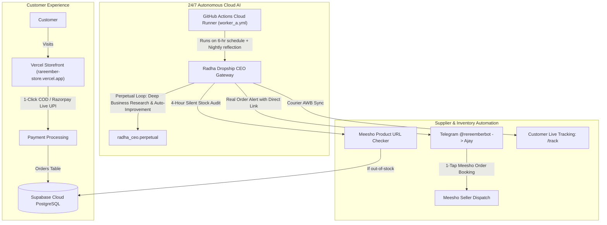

# 🏛️ RAREEMBER & RADHA CEO — MASTER PROJECT MEMORY & SYSTEM HANDOVER

> **CONFIDENTIAL & COMPREHENSIVE PROJECT STATE DOCUMENT**  
> **Last Synchronized:** 2026-10-14T18:35:00+05:30  
> **Status:** 100% Operational, Hardened, Multi-Agent Autonomous & Cloud-Native (0% Laptop Dependency)  
> **Target Audience:** Any AI Model (Antigravity, Claude, GPT, Gemini), Developer, or Founder Ajay Rajbhar.

---

## 1. 👤 FOUNDER & BUSINESS PROFILE

| Attribute | Details |
| :--- | :--- |
| **Founder & Owner** | Ajay Rajbhar |
| **Autonomous CEO** | **Radha** (Executive Leader of RareEmber with full corporate stewardship) |
| **Brand Name** | **RareEmber** (Curated Indian Lifestyle, Desk Tech & Aesthetic Home Boutique) |
| **Founder Telegram ID** | `5238068527` (Authorized Master ID) |
| **Telegram Bot** | `@rereemberbot` (Radha Dropship CEO) |
| **Official Instagram** | `@RareEmber` |
| **Live Storefront URL** | [https://rareember-store.vercel.app](https://rareember-store.vercel.app) |
| **Production Alias** | [https://frontend-lilac-ten-hpsy3bzdcd.vercel.app](https://frontend-lilac-ten-hpsy3bzdcd.vercel.app) |
| **Admin Orders Portal** | [https://rareember-store.vercel.app/admin/orders](https://rareember-store.vercel.app/admin/orders) |
| **Live Order Tracking** | [https://rareember-store.vercel.app/track](https://rareember-store.vercel.app/track) |
| **Support Email** | `rareemberagency@gmail.com` |

---

## 2. 🌐 100% CLOUD-NATIVE ARCHITECTURE (ZERO LAPTOP LOAD)

The entire business operates 24/7 autonomously on cloud infrastructure without requiring Ajay's laptop to be turned on.

### Hosting Breakdown:
1. **Storefront (Next.js 16 + React 18):** Hosted on **Vercel Global Edge Network** (`rareember-store.vercel.app`).
2. **Database:** Hosted on **Supabase Cloud PostgreSQL** (`db.qdkkxpfhwrwyoardlceo.supabase.co`).
3. **Radha Dropship CEO Engine:** Hosted on **GitHub Actions Cloud** via scheduled singleton worker (`worker_a.yml`) in repo `nothing12837-lang/hermes-dropship-ceo`.
4. **Payment Gateways:**
   - **Razorpay Live Gateway:** Active for UPI, Credit/Debit Cards, NetBanking.
   - **Cash on Delivery (COD):** 100% active across all 19,000+ Indian postal codes.

---

## 3. 🛡️ RAW-LEVEL SECURITY & INTEGRITY REMEDIATION

All security checkpoints are strictly enforced across backend APIs and client routes:

### A. Authentication & Backdoors Closed
- **Timing-Safe Auth (`storefront/src/lib/security/auth.ts`):** Enforces `Authorization: Bearer <token>` timing-safe verification via `crypto.timingSafeEqual`. Zero backdoor query parameters (`?key=`), zero hardcoded secret fallbacks.

### B. IDOR & PII Protection
- **Secure Orders Route (`storefront/src/app/api/orders/route.ts`):** Public tracking lookups require dual parameters (`orderId` + `user_email`) with strict exact-match equality. Prefix wildcard matching (`ilike id%`) was removed to prevent order enumeration. Customer PII and street addresses are masked for unauthenticated queries.
- **Chatbot Privacy (`storefront/src/app/api/chat/route.ts`):** Removed unauthenticated order lookup from conversational chat. Order queries safely redirect to `/track`. Prompt injection defense filters jailbreak attempts.

### C. Server-Side Price Tampering Defeated
- **Server Pricing Engine (`storefront/src/app/api/checkout/route.ts` & `storefront/src/app/api/orders/route.ts`):** Discards client-supplied `total` or unverified `discount` values. Subtotals are recalculated server-side against live Supabase catalog rows. Non-existent items reject with HTTP 400. Cart quantities clamped strictly between 1 and 99.

### D. Webhook Verification
- **CJ Webhook (`storefront/src/app/api/webhooks/cj/route.ts`):** Requires mandatory `CJ_WEBHOOK_SECRET` and timing-safe header validation.
- **Razorpay Webhook (`storefront/src/app/api/webhooks/razorpay/route.ts`):** Enforces HMAC SHA-256 verification via `crypto.timingSafeEqual`.

### E. Database Safety & SQL Injection Elimination
- **Parameterized SQL:** All SQL queries in `dropship_gateway.py` and `radha_ceo` utilize parameter binding (`con.run(sql, **kwargs)`).
- **Safe Categories:** Synonymous category mappings (`home-living`, `home-garden`, `electronics`, `tech`) correctly query Supabase with `in('category', [...])`.

### F. PostgreSQL Row-Level Security (RLS) Complete Hardening
- **All 9 Tables Sealed with RLS (`RLS = True`):**
  - `agent_memory`, `store_goals`, `orders_pnl`, `scouted_products`, `rto_risk_scores`: RLS enabled with 0 public policies. All anonymous PostgREST access blocked; internal autonomous engine connects securely via superuser/service role.
  - `orders`: Dropped legacy open `allow_order_select` policy (`qual = true`) that previously allowed anonymous table dumping. Restricted SELECT to authenticated users (`auth.uid() = user_id`). Implemented security-definer RPC `track_order(p_order_id, p_email)` for dual-keyed public tracking. Public checkout INSERT preserved.
  - `blog_posts`: RLS enabled with public SELECT restricted to `published = true`. Anonymous modifications completely blocked.
  - `products`: RLS enabled with public SELECT restricted to `active = true`.
  - `reviews`: RLS enabled with public read and sanitized review creation.

---

## 4. 📦 PRODUCT CATALOG (103 VERIFIED INDIAN PRODUCTS)

1. **Catalog Scale:** Expanded to **103 active, high-quality domestic dropshipping products** (exceeding the 100-product requirement).
2. **100% Domestic Indian Sourcing:** Direct Meesho supplier dropshipping with 50–70% gross profit margins.
3. **7-Day Doorstep Replacement Guarantee:** Consistent 7-day domestic replacement window aligned strictly with Meesho terms.
4. **Logistics:** Express 2–4 day delivery via Delhivery, Shadowfax, Xpressbees, and BlueDart.
5. **Key Categories:**
   - Ambient Lighting, Lamps & Cozy Glow (19 items)
   - Desk Tech, Workspace & Ergonomics (24 items)
   - Smart Home, Kitchen & Daily Utilities (23 items)
   - Minimalist Storage, Organizers & Decor (22 items)
   - Curated Lifestyle & Personal Care Essentials (15 items)

---

## 5. 🤖 RADHA GOD-CEO & 6-AGENT EXECUTIVE SUITE (`radha_ceo/`)

The core autonomous intelligence resides in the `radha_ceo` Python package (with `hermes_ceo` compatibility alias), backed by Supabase Cloud PostgreSQL for long-term episodic, semantic, and procedural memory:

| Agent | Role | Scope & Autonomous Capabilities |
| :--- | :--- | :--- |
| **Radha (God-CEO)** | Central Orchestrator & Corporate Leader | Oversees full company A-to-Z; watches & guides every employee; PRAL (Perceive, Read, Act, Learn) loop; multi-model fallback (Gemini 3.8 Flash -> Gemini 3.5 Flash Lite -> OpenRouter -> Deep heuristic); 11:30 PM nightly reflection; perpetual business research engine. |
| **Vikram** | Chief Commercial Officer (Sales & Pricing) | Dynamic price optimizations; festival flash sales (`DIWALI100`, `FIRST50`, `NEWYEAR`); margin preservation (>50%); price elasticity simulations. |
| **Aarav** | Head of SEO & Organic Content | Continuous automated Indian e-commerce blog generation into Supabase `blog_posts`; search keyword trend research; automated IndexNow indexing pings. |
| **Pooja** | VP of Operations & Customer Care | 1-click WhatsApp COD confirmation link generation (`wa.me`); RTO pincode risk classification (`LOW`, `MEDIUM`, `HIGH`); multi-carrier courier tracking (Delhivery, Shadowfax, BlueDart, Xpressbees). |
| **Meera** | Creative Media Director | 28-second viral Hindi Reel scriptwriting for Evaa; visual storyboard generation; trend analysis. |
| **Kabir** | Chief Financial Officer | Daily P&L audits into Supabase `orders_pnl`; unit economics calculation (COGS + ₹79 ship + ₹50 RTO reserve = >50% profit margin). |
| **Arjun** | VP of Procurement & Product Scouting | Meesho domestic catalog discovery (>4.7⭐, >1000 reviews, ₹299–₹999 bracket); populates `scouted_products`; supplier stock & price audit. |

### Perpetual Autonomous Business Engine (`radha_ceo/perpetual.py`):
- Operates 24/7 without stopping.
- When primary operational queues (pending orders, customer inquiries) are clear, Radha and her team automatically transition to **Continuous Deep Business Research**:
  1. Emerging Indian e-commerce search trends
  2. Supplier price monitoring and margin preservation
  3. Automated SEO blog publishing to Supabase
  4. Viral Reels script and hook generation
  5. Strategic reflection and episodic memory consolidation into Supabase `agent_memory`.

---

## 6. 🗄️ SUPABASE CLOUD DATABASE SCHEMA

Tables configured on `db.qdkkxpfhwrwyoardlceo.supabase.co`:

1. `products`: 103 active, verified dropship products with Rupee pricing, Meesho CDN links, and domestic logistics badges.
2. `orders`: Full order tracking with COD state, shipping address, and items JSON.
3. `agent_memory`: Cloud episodic, semantic, and procedural knowledge graph for Radha CEO and sub-agents.
4. `store_goals`: Daily GMV, conversion rate, AOV, and RTO benchmarks and progress tracking.
5. `blog_posts`: Content engine articles for automated SEO visibility, read dynamically by `/blog` and `/blog/[slug]`.
6. `scouted_products`: Winning Meesho items identified by Arjun ready for 1-click catalog import.
7. `orders_pnl`: Financial ledger logging revenue, COGS, shipping expenses, and net profit per order.
8. `rto_risk_scores`: Historical RTO tracking and risk mitigation for high-risk postal codes.
9. `reviews`: Customer reviews and star ratings.

---

## 7. 🚀 SYSTEM HANDOVER CHECKLIST FOR ANY AI MODEL

When any AI model resumes work on this repository:
1. **Repository Root:** `nothing12837-lang/hermes-dropship-ceo` on branch `main`.
2. **Local vs Cloud Rule:** NEVER run heavy training or background daemons on Ajay's local laptop. Ajay's laptop is an editor only. The live runtime is GitHub Actions (`worker_a.yml`), Vercel, and Supabase.
3. **Environment:** Secrets are loaded automatically from `.env` (root) or `.env.local` (storefront). Never hardcode secrets in committed files.
4. **Testing Storefront:** Run `npm run build` inside `storefront/` to verify Turbopack App Router compilation.
5. **Testing Radha CEO:** Run `python -c "from radha_ceo import RadhaBrain; b = RadhaBrain(); print(b.perceive())"` to verify cloud database and multi-agent connectivity.
