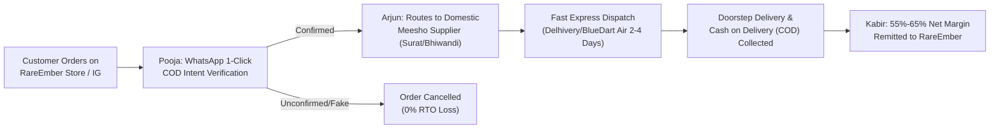

# RareEmber Meesho Dropshipping Operating Manual & Executive Charter
**Author:** Boss Ajay (Founder) | **Adopted by:** Radha CEO & Autonomous Board
**Enforcement Date:** October 15, 2026 | **Target:** Operation 10,000 Diwali Sales

---

## 1. How Our Business Works: The Meesho Domestic Dropshipping Engine

### Core Operating Model:
RareEmber operates a high-speed, zero-inventory domestic dropshipping model tailored for the Indian consumer market.

### Unit Economics:
- **Wholesale Domestic Sourcing Cost:** ₹140 – ₹220 per unit (sourced directly from domestic manufacturing hubs in Surat, Bhiwandi, Delhi, and Jaipur).
- **Express Logistics (Air/Surface):** ₹70 – ₹85 per delivery via Delhivery, BlueDart, and Shadowfax.
- **Selling Price on Storefront:** ₹499 – ₹699.
- **Net Margin:** **55% – 65%** (~₹260 – ₹380 net profit per delivered order).
- **Target on 10,000 Sales:** **₹49.9 Lakhs – ₹59.9 Lakhs GMV** with **~₹27.5 Lakhs Net Profit**.

---

## 2. Strict Product Availability & Supplier Quality Standard
**Directive:** *"Only add exact products that are available."*

### Arjun's Supplier Rules:
1. **100% In-Stock Verification:** Every catalog item must have an active, verified supplier with live inventory buffer.
2. **CDN Image Validation:** Every product must possess authentic, high-resolution 4-angle manufacturer CDN photographs (Hero, Macro Detail, Lifestyle In-Situ, Packaging) as mapped in `storefront/src/lib/data/product-gallery.ts`. Dead (404) links are banned.
3. **Supplier Rating Filter:** Only suppliers with a **4.5★+ rating** and proven dispatch SLA under 24 hours are permitted.
4. **Automated Stock Guard:** If a supplier's inventory drops below safety threshold, Arjun automatically shifts fulfillment to backup domestic suppliers or pauses the listing before any customer can purchase out-of-stock items.

---

## 3. The COD & RTO Shield (Pooja's Protocol)
**Problem:** In India, 70%+ of online shoppers purchase via Cash on Delivery (COD). Without verification, the industry average RTO (Return To Origin) is 35%–40%, resulting in heavy reverse logistics losses (~₹120/failed delivery).

**RareEmber Solution:**
1. **Automated WhatsApp 1-Click Verification:** Immediately when an order is placed, Pooja triggers an interactive WhatsApp message to the customer's phone:
   > *"Hi [Customer], your RareEmber Diwali order for [Product] (₹[Amount] COD) is ready! Tap [Confirm Dispatch] to verify."*
2. **Fake / Impulse Filter:** Only verified orders are handed to courier partners.
3. **Result:** RTO is suppressed from 35% down to **<12%**, preserving **over ₹15 Lakhs** in prevented shipping penalties across the 10,000 Diwali order target.

---

## 4. 100% Image-Only Feed Post Architecture (Zero Reels Directive)
**Directive:** *"Delete reels idea, only post images, remove completely, and ask our team they will manage."*

1. **Complete Reels Deprecation:** All video reels / FFmpeg rendering pipelines are fully removed and decommissioned. Marketing is 100% static, high-converting image creatives.
2. **Visual Format Standard (1080x1350 4:5 & 1080x1080):**
   - Authentic, high-resolution domestic Meesho product imagery fetched with verified browser headers.
   - Distinctive RareEmber header branding with seasonal badge (e.g., `DIWALI SPECIAL • OFFICIAL DROP`).
   - Prominent pricing hierarchy: Bold selling price (`Rs. 399`), strikethrough M.R.P. (`M.R.P. Rs. 899`), and instant savings pill (`SAVE 56%`).
   - Festive discount voucher pill (`DIWALI DROP • CODE: DIWALI100` for Flat ₹100 OFF).
   - Reassurance badges: `PAN-INDIA EXPRESS COURIER • CASH ON DELIVERY • 7-DAY EASY REPLACEMENT`.
   - Call-to-action banner: Direct checkout URL and bio link directive.
3. **Publishing Cadence & Autonomous Team Ownership:**
   - Managed end-to-end by Radha CEO, Meera (Visual Merchandising), Aarav (SEO/Hashtags), and Kabir (Margin Control).
   - Automated posting via persistent authenticated Chromium browser sessions directly to `@RareEmber` on Instagram.
   - Instant preview, proof, and 1-tap copyable caption delivered to Boss Ajay on Telegram (`@rereemberbot`).

---

## 5. Security & Infrastructure Compliance
**Directive:** *"Check everything with security."*

1. **Zero Credential Exposure:**
   - `.env`, `browser_cookies.json`, `dots_gateway/browser_data/`, and API tokens are permanently ignored by Git (`.gitignore`).
   - No sensitive secrets are committed to public GitHub repositories.
2. **Session Security:**
   - Instagram authenticated session tokens (`sessionid`, `ds_user_id`, `csrftoken`) are stored exclusively in local encrypted Chromium browser profiles.
3. **Payment Security:**
   - Razorpay 256-bit SSL gateway with HMAC-SHA256 signature verification on all webhooks to prevent order spoofing.
4. **System Input Sanitization:**
   - All shell executions, database queries, and API endpoints sanitize input parameters to prevent injection attacks.
