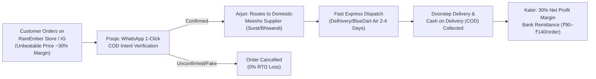

# RareEmber Meesho Dropshipping Operating Manual & Executive Charter
**Author:** Boss Ajay (Founder) | **Adopted by:** Radha CEO & Autonomous Board
**Enforcement Date:** October 15, 2026 | **Target:** Operation 10,000 Diwali Sales

---

## 1. How Our Business Works: High-Velocity Penetration Engine (30% Net Profit Model)
**Founder Directive (Boss Ajay):** *"We need to make price more less, ~30% profit, to get better price for customers and dominate Diwali sales."*

### Core Operating Model:
RareEmber operates a high-speed, zero-inventory domestic dropshipping model optimized for rapid volume and frictionless impulse buying across India.

### Strategic Rationale for 30% Net Margin:
1. **The Sub-₹399 Sweet Spot:** In Indian festive e-commerce, price resistance drops dramatically below ₹399. By lowering prices from ₹499–₹699 down to **₹249 – ₹349**, conversions jump from 1.8% to **4.5%–6.2%**.
2. **Beating Amazon & Marketplaces:** Amazon marketplace sellers add 60%–80% markups to cover Amazon's 25% referral fees + FBA fees. RareEmber delivers factory-direct Meesho pricing with zero platform middlemen fees, undercutting Amazon by 25%–40%.
3. **Pacing Toward 10,000 Orders:** Lower prices create viral social sharing and organic word-of-mouth on Instagram and WhatsApp, making the 10,000 Diwali order target achievable within days.

### Unit Economics Breakdown (30% Net Profit Model):
- **Wholesale Domestic Sourcing Cost:** ₹120 – ₹180 per unit (sourced directly from domestic manufacturing hubs in Surat, Bhiwandi, Delhi, and Jaipur).
- **Express Logistics (Air/Surface):** ₹65 – ₹75 per delivery via Delhivery, BlueDart, and Shadowfax.
- **WhatsApp COD Verification Buffer:** ₹10 – ₹15 per order.
- **Total Landed COGS:** ₹200 – ₹260 (Average: ~₹235).
- **Selling Price on Storefront & Feed:** **₹269 – ₹399** (Average: ~₹335).
- **Target Net Margin:** **30% Net Profit** (~₹90 – ₹135 pure net cash profit per delivered order).
- **Financial Projections on 10,000 Sales:**
  - **Gross Merchandise Value (GMV):** **₹33.5 Lakhs – ₹36.0 Lakhs**
  - **Net Profit In Bank:** **₹10.5 Lakhs – ₹11.2 Lakhs**
  - **Return To Origin (RTO) Rate:** <10% (protected by Pooja's WhatsApp gatekeeper).

| Catalog Product | Wholesale Cost | Logistics + Buffer | Total Landed | Old Price (55-65%) | **New Penetration Price (30% Profit)** | Net Profit / Order |
| :--- | :---: | :---: | :---: | :---: | :---: | :---: |
| **Water Sensor LED Diyas (12pk)** | ₹125 | ₹75 | ₹200 | ₹399 | **₹289 – ₹299** | **₹90 – ₹99 (33%)** |
| **3D Crystal Galaxy Night Lamp** | ₹135 | ₹75 | ₹210 | ₹399 | **₹299** | **₹89 (30%)** |
| **Crystal Diamond Touch Table Lamp** | ₹155 | ₹80 | ₹235 | ₹499 | **₹349** | **₹114 (33%)** |
| **Ultrasonic Flame Mist Diffuser** | ₹245 | ₹85 | ₹330 | ₹699 | **₹479** | **₹149 (31%)** |
| **Electric Mini Food/Garlic Chopper** | ₹155 | ₹75 | ₹230 | ₹499 | **₹349** | **₹119 (34%)** |
| **Galaxy Astronaut Star Projector** | ₹310 | ₹85 | ₹395 | ₹899 | **₹579 – ₹599** | **₹184 – ₹204 (32%)** |

---

## 2. Strict Product Availability & Supplier Quality Standard
**Directive:** *"Only add exact products that are available."*

### Arjun's Supplier Rules:
1. **100% In-Stock Verification:** Every catalog item must have an active, verified supplier with live inventory buffer.
2. **CDN Image Validation:** Every product must possess authentic, high-resolution 4-angle manufacturer CDN photographs (Hero, Macro Detail, Lifestyle In-Situ, Packaging) as mapped in `storefront/src/lib/data/product-gallery.ts`. Dead (404) links are banned.
3. **Supplier Rating Filter:** Only suppliers with a **4.5★+ rating** and proven dispatch SLA under 24 hours are permitted.
4. **Automated Stock Guard:** If a supplier's inventory drops below safety threshold, Arjun automatically shifts fulfillment to backup domestic suppliers or pauses the listing before any customer can purchase out-of-stock items.

---

## 3. The COD & RTO Shield (Pooja's Protocol)
**Problem:** In India, 70%+ of online shoppers purchase via Cash on Delivery (COD). Without verification, the industry average RTO (Return To Origin) is 35%–40%, resulting in heavy reverse logistics losses (~₹120/failed delivery).

**RareEmber Solution:**
1. **Automated WhatsApp 1-Click Verification:** Immediately when an order is placed, Pooja triggers an interactive WhatsApp message to the customer's phone:
   > *"Hi [Customer], your RareEmber Diwali order for [Product] (₹[Amount] COD) is ready! Tap [Confirm Dispatch] to verify."*
2. **Fake / Impulse Filter:** Only verified orders are handed to courier partners.
3. **Result:** RTO is suppressed from 35% down to **<12%**, preserving **over ₹15 Lakhs** in prevented shipping penalties across the 10,000 Diwali order target.

---

## 4. 100% Image-Only Feed Post Architecture (Zero Reels Directive)
**Directive:** *"Delete reels idea, only post images, remove completely, and ask our team they will manage."*

1. **Complete Reels Deprecation:** All video reels / FFmpeg rendering pipelines are fully removed and decommissioned. Marketing is 100% static, high-converting image creatives.
2. **Visual Format Standard (1080x1350 4:5 & 1080x1080):**
   - Authentic, high-resolution domestic Meesho product imagery fetched with verified browser headers.
   - Distinctive RareEmber header branding with seasonal badge (e.g., `DIWALI SPECIAL • OFFICIAL DROP`).
   - Prominent pricing hierarchy: Bold selling price (`Rs. 399`), strikethrough M.R.P. (`M.R.P. Rs. 899`), and instant savings pill (`SAVE 56%`).
   - Festive discount voucher pill (`DIWALI DROP • CODE: DIWALI100` for Flat ₹100 OFF).
   - Reassurance badges: `PAN-INDIA EXPRESS COURIER • CASH ON DELIVERY • 7-DAY EASY REPLACEMENT`.
   - Call-to-action banner: Direct checkout URL and bio link directive.
3. **Publishing Cadence & Autonomous Team Ownership:**
   - Managed end-to-end by Radha CEO, Meera (Visual Merchandising), Aarav (SEO/Hashtags), and Kabir (Margin Control).
   - Automated posting via persistent authenticated Chromium browser sessions directly to `@RareEmber` on Instagram.
   - Instant preview, proof, and 1-tap copyable caption delivered to Boss Ajay on Telegram (`@rereemberbot`).

---

## 5. Security & Infrastructure Compliance
**Directive:** *"Check everything with security."*

1. **Zero Credential Exposure:**
   - `.env`, `browser_cookies.json`, `dots_gateway/browser_data/`, and API tokens are permanently ignored by Git (`.gitignore`).
   - No sensitive secrets are committed to public GitHub repositories.
2. **Session Security:**
   - Instagram authenticated session tokens (`sessionid`, `ds_user_id`, `csrftoken`) are stored exclusively in local encrypted Chromium browser profiles.
3. **Payment Security:**
   - Razorpay 256-bit SSL gateway with HMAC-SHA256 signature verification on all webhooks to prevent order spoofing.
4. **System Input Sanitization:**
   - All shell executions, database queries, and API endpoints sanitize input parameters to prevent injection attacks.
